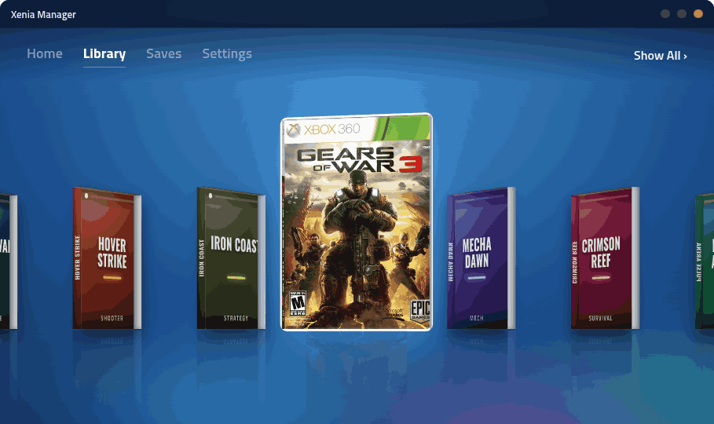
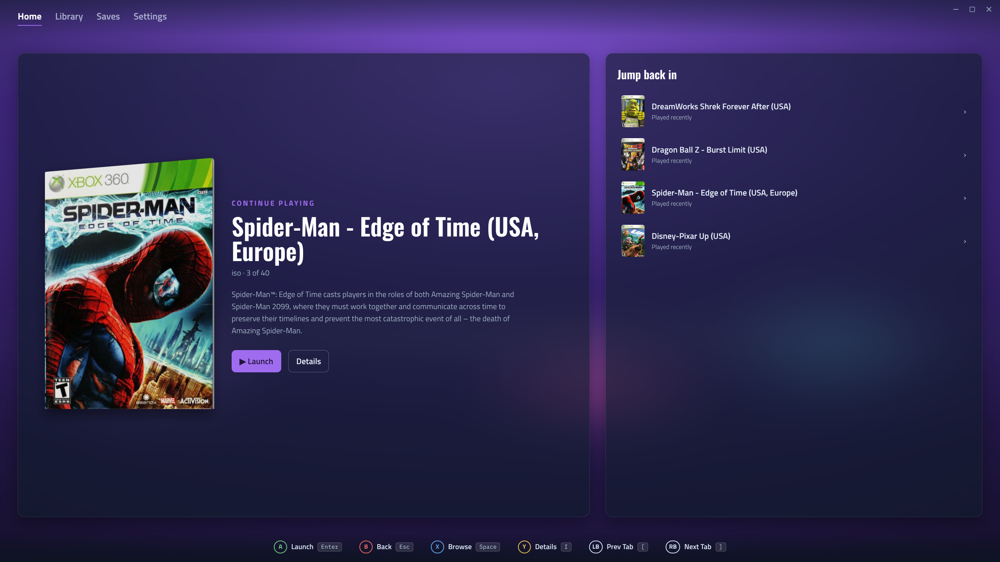
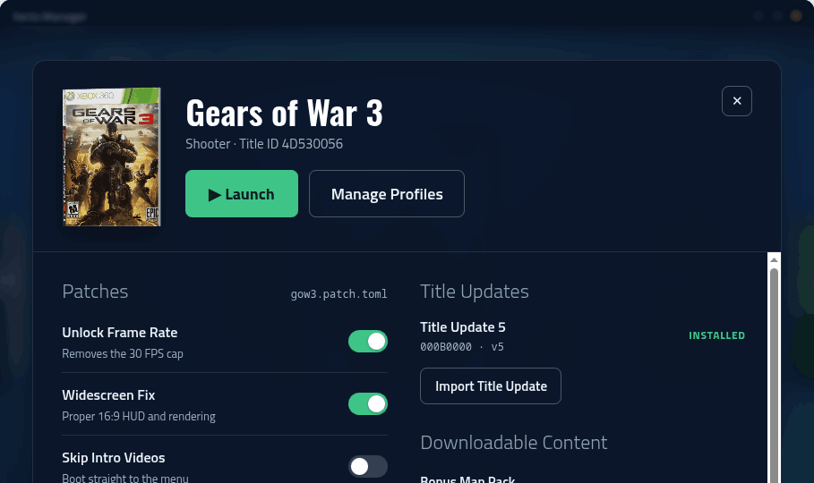
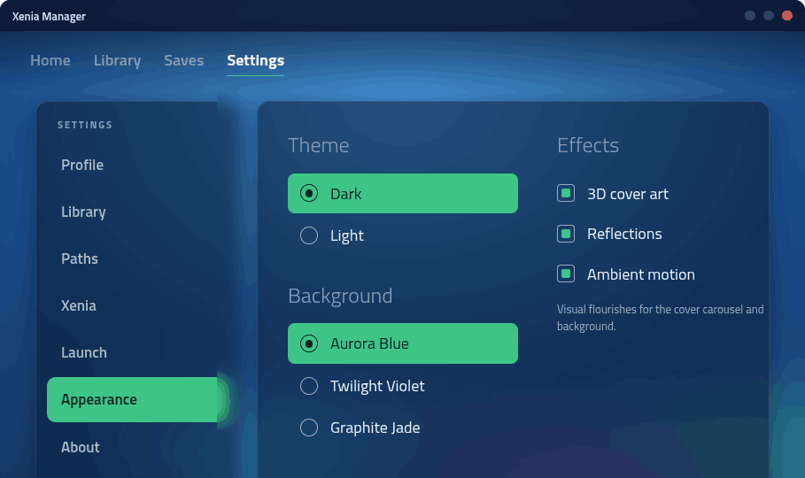

# Xenia Manager for Linux

A desktop app for managing and launching your Xbox 360 games with the
[Xenia](https://xenia.jp/) emulator on Linux.

It keeps your library, your Xenia builds, your saves and your per-game tweaks
in one place, behind an interface modeled on the Xbox 360's Aurora dashboard.
It is built with Electron and React on top of a small Rust core (`xlm-core`)
that does the heavy lifting: scanning, downloading, launching and talking to
Xenia.

Status: early `0.1.x` releases. It works, but expect rough edges, and please
open an issue if you hit one.

## Not affiliated with Xenia; no games included

This is an independent project. It is not affiliated with or endorsed by the
Xenia project, Microsoft or any game publisher. It does not include Xenia,
games, firmware or any other copyrighted content. It downloads official Xenia
Canary or Xenia Edge builds from their own GitHub release pages when you ask it
to, and you supply your own legally owned game dumps.

## Screenshots

The library, as a coverflow of 3D cases you can steer with a controller or the
keyboard:



Home picks up where you left off:



Each game opens a details view with a synopsis and screenshots, plus tabs for
patches, extra content, launch profiles and saves:



Settings, from library sources and scanning to cover art and how the library is
laid out:



## What it does

- **Library.** Point it at your game folders and it scans them and fetches box
  art (full 3D-case wraps from XboxUnity, plus titles and artwork from the
  `x360db` game database). Three ways to browse: a blade carousel, a rail with
  carousel, or a grid wall.
- **Per-game setup.** Manage patches (including community patches from the
  `xenia-canary/game-patches` repository), title updates and DLC, and save
  launch profiles per title.
- **Saves.** Browse your saves, and export or import them as archives, without
  digging through Xenia's data directory.
- **Xenia builds.** Download, track and switch between Xenia Canary and Xenia
  Edge Linux releases from inside the app.
- **Shortcuts.** Add a game to Steam as a non-Steam shortcut, or create a
  desktop shortcut.
- **Controller-first.** The whole interface works with a gamepad or the
  keyboard, including an on-screen keyboard for text entry.
- **Looks.** Dark and light themes, background palettes, and toggles for the
  3D cover art, reflections and motion.
- **Updates itself.** The AppImage checks GitHub Releases for new versions and
  offers to restart into the update.

## Download and install

Download the latest `.AppImage` from the
[Releases](https://github.com/sergen213/xenia-linux-manager/releases) page,
then:

```bash
chmod +x xenia-linux-manager-*.AppImage
./xenia-linux-manager-*.AppImage
```

On first launch a setup wizard asks for your paths. After that the app updates
itself in the background and tells you when a new version is ready.

## Requirements

- 64-bit (x86_64) Linux desktop, X11 or Wayland.
- A system that can run the Linux builds of Xenia Canary or Xenia Edge.
- Your own legally owned Xbox 360 game dumps.

## Build from source

You need Node.js (CI uses Node 22), npm and a stable Rust toolchain (Cargo).

```bash
npm install
npm run build:sidecar   # compiles the Rust core (xlm-core)
npm run dev             # runs the app against the Vite dev server
```

To produce an AppImage in `release/`:

```bash
npm run dist            # builds the sidecar, the app and the AppImage
```

Tests: `npm test`, `npm run test:electron` and
`cargo test --manifest-path core/Cargo.toml`. More detail, including how the
Electron shell finds the sidecar, is in [electron/README.md](electron/README.md).

## Documentation

- [electron/README.md](electron/README.md) — Electron host, dev and packaging notes.
- [docs/release/appimage-verification-checklist.md](docs/release/appimage-verification-checklist.md) — release checklist for AppImage builds.
- [docs/specs/2026-06-17-native-titlebar-design.md](docs/specs/2026-06-17-native-titlebar-design.md) — native title bar design.
- [docs/plans/2026-06-17-native-titlebar.md](docs/plans/2026-06-17-native-titlebar.md) — native title bar implementation plan.

## Contributing

Changes are accepted only as pull requests to this repository, reviewed and
merged by the maintainer. See [CONTRIBUTING.md](CONTRIBUTING.md).

## License

Source-available, all rights reserved — see [LICENSE](LICENSE). You may read
the code, build and run it for your own personal, non-commercial use, and fork
it only to prepare pull requests. Versions published under a different license
before this license was added remain available under that earlier license.
Third-party components keep their own licenses.
